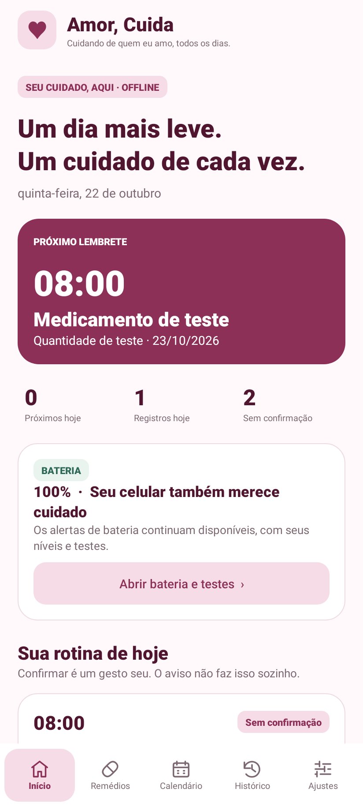

# Amor, Cuida 2.0 ♥

Aplicativo Android offline de cuidados e lembretes. Evolui o Amor, Carrega, preservando o monitoramento da bateria e adicionando medicamentos, confirmações manuais, histórico de correções e calendário local.

**Cuidando de quem eu amo, todos os dias.**

## Downloads desta versão

- [Projeto completo em ZIP](https://github.com/Pedrinhocoder/App-da-Emily/archive/refs/heads/codex/amor-cuida-2-0.zip)
- [APK 2.0 de teste](https://github.com/Pedrinhocoder/App-da-Emily/raw/refs/heads/codex/amor-cuida-2-0/Amor-Cuida-2.0-debug.apk)

## Abrir no Android Studio

1. Extraia o ZIP do projeto.
2. Use **Open** e selecione a pasta **`android`**, onde está `settings.gradle.kts`.
3. Configure o Gradle JDK para **17 ou 21**, instale a plataforma Android **35** pelo SDK Manager e sincronize.
4. Execute o módulo `app` em um aparelho/emulador Android 8.0 ou superior.

O wrapper já usa **Gradle 8.7**, com checksum oficial. Não é necessário trocar a versão manualmente. Dependências precisam de Internet na primeira sincronização; o aplicativo funciona offline depois de instalado.

## Interface

Renderizações das Views reais em testes JVM/Skia, com dados fictícios (não capturas de um aparelho):



[Calendário](docs/imagens/calendario-2-0.png) · [Medicamentos](docs/imagens/medicamentos-2-0.png) · [Histórico](docs/imagens/historico-2-0.png) · [Cadastro](docs/imagens/cadastro-2-0.png)

## O que a versão 2.0 faz

- **Início:** próximos lembretes, resumo do dia e acesso ao monitoramento da bateria.
- **Medicamentos:** nome, apresentação, concentração, quantidade conforme prescrição, vários horários, dias da semana ou intervalo em dias, início e término opcional. Alterações podem começar hoje ou em uma data futura, preservando os esquemas anteriores.
- **Confirmação manual:** quantidade realmente administrada, data e hora reais. Um aviso nunca confirma uma administração sozinho.
- **Calendário offline:** marca a data real informada na administração. Permite consultar os registros e os lembretes de cada dia.
- **Histórico:** administrações e correções com motivo, valores anteriores e novos, e data da alteração.
- **Avisos locais:** AlarmManager, notificações breves, som/vibração opcionais e reprogramação após reinício, mudança de hora/fuso e alterações de cadastro/permissões.
- **Bateria:** níveis configurável, 15%, 5% e 1%, monitoramento, alertas e testes da base anterior continuam no módulo Bateria.

O app organiza uma prescrição cadastrada pelo usuário. Não calcula doses, não recomenda compensações e não substitui orientação profissional. Não integra Google Agenda, calendário do Motorola, contas ou serviços de nuvem.

## Desenvolvimento

| Componente | Versão |
|---|---|
| Android Gradle Plugin | 8.6.1 |
| Gradle | 8.7 |
| Kotlin / KSP | 2.0.21 / 2.0.21-1.0.28 |
| Room | 2.7.2 |
| Java/Kotlin bytecode | 17 |
| Android mínimo / alvo | 26 / 35 |
| Aplicativo | 2.0.0 (`versionCode` 2) |

Na pasta `android`:

```bash
./gradlew :app:assembleDebug :app:testDebugUnitTest :app:lintDebug
```

Os testes instrumentados usam um **emulador dedicado**; um deles alterna rede/permissões para verificar o alarme offline. Consulte [testes e validação](docs/VALIDACAO.md) antes de executá-los.

Na nuvem, use os helpers descritos em [AMBIENTE.md](docs/AMBIENTE.md). O APK debug é gerado em `android/app/build/outputs/apk/debug/app-debug.apk`.

## Dados e atualização

O identificador continua `br.com.pedrinho.amorcarrega`. As preferências de bateria permanecem no arquivo `config`; os medicamentos usam um banco Room separado, `amor_cuida.db`. O histórico não é apagado ao arquivar um medicamento. O banco não usa migração destrutiva.

Os dados ficam no aparelho e não têm backup automático em nuvem. Desinstalar o aplicativo ou limpar seus dados apaga os registros locais. Uma atualização mantém os dados somente quando pacote e assinatura são compatíveis. Para atualizar uma instalação feita no seu Android Studio, use a mesma chave original. O APK da nuvem usa uma chave de desenvolvimento e pode ter assinatura diferente da instalada no celular.

Leia também a [arquitetura](docs/ARQUITETURA.md), o [estado da implementação](docs/EVOLUCAO-2.0.md) e o [roteiro fornecido](docs/Amor_Cuida_2_0_Roteiro_Oficial.pdf). Testes no Motorola continuam necessários para comportamento do fabricante, tela bloqueada, som, vibração e atualização sobre a versão instalada.
